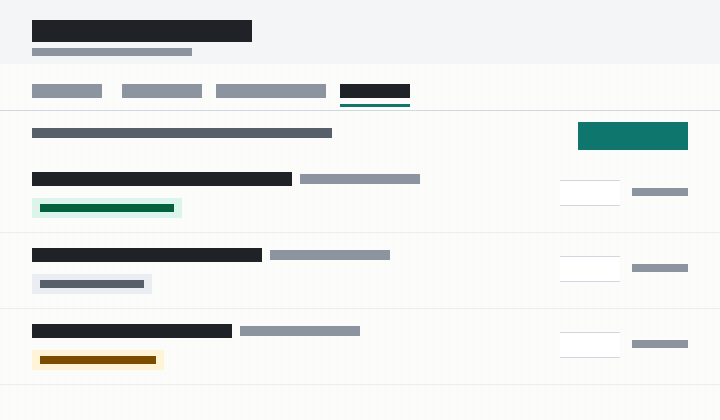

# The member page

A guide for the desk: what a member sees on the member page, and how to help.

## Loans

The books that the member has at home, with their due days. A member can renew a loan here when nobody waits for the book.

## History

The books that the member borrowed before. A member can switch the history off; then the library keeps no history for that member.

## Reading lists

Lists of books that a member keeps, for example for a reading club. A list can be shared with a link.

## Holds

A member can hold a book that is out, and pick the branch where the book should wait. The tab "Holds" shows each hold with its place in the line.

- **Waiting**: the member is in the line. The number is the place in the line.
- **Paused**: the member keeps the place, but the next copy goes to the member after. A pause ends on its day by itself.
- **Ready**: a copy waits on the ready shelf of the branch until the last pickup day.

When a member comes for a ready hold, scan the card and the copy: the hold is done, and the copy is on loan. A ready copy that nobody picks up goes to the next member after the last pickup day; the member goes to the end of the line.

A member with no mail address gets no notice. The desk summary of the morning lists those members, so the desk can call them.
